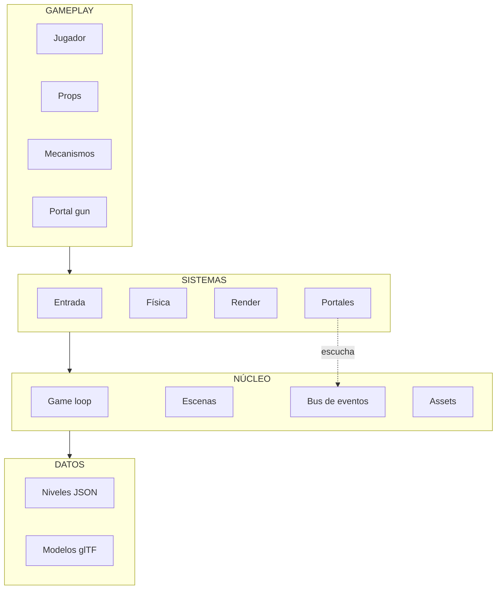
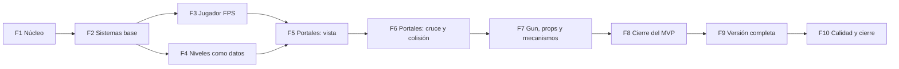

# Plan del proyecto: recreación académica 3D tipo Portal (web)

Documento de trabajo para el equipo: define el alcance, la arquitectura y las fases del
proyecto con sus criterios de aceptación. La meta final es un nivel jugable en el
navegador, publicado como sitio estático en GitHub Pages.

---

## 1. Stack

| Función | Herramienta | Nota |
|---|---|---|
| Render 3D | **Three.js** | Alternativa: Babylon.js. |
| Física | **Rapier** (`@dimforge/rapier3d-compat`, WASM) | Incluye controlador de personaje kinemático (útil para el jugador). Alternativa más simple: cannon-es. |
| Build | **Vite** (JavaScript ESM) | Salida estática en `dist/`. Decisión tomada: **sin TypeScript**. |
| Controles FPS | **Pointer Lock API** | Nativa, sin librerías. |
| Niveles | **TrenchBroom** (mapas de bloques) o **Blender → glTF** | Geometría tipo cajas. |
| Audio | **Howler.js** o Web Audio | Fuera del MVP. |
| Assets | CC0: Kenney, Poly Haven, freesound | Sin material de Valve. |

### Restricciones de despliegue (GitHub Pages)

- 100 % cliente: HTML, JS, WASM y assets estáticos.
- **No se pueden configurar cabeceras HTTP** (COOP/COEP) → sin `SharedArrayBuffer` →
  **sin multihilo en WASM**. Rapier corre en un solo hilo; es suficiente.
- Por eso se usa `rapier3d-compat` (WASM incrustado en el JS) para evitar problemas de
  tipo MIME.
- `base: '/Portal_Web_2026-II/'` ya está configurado en `vite.config.js`.
- Límites: ~1 GB por repositorio, 100 MB por archivo, ~100 GB/mes de ancho de banda.
- Optimizar peso en fases tardías: texturas WebP/KTX2, glTF con Draco o meshopt.
- Solo assets propios o CC0 (repositorio público, plan gratuito).

---

## 2. Arquitectura en capas

Cada capa solo depende de la que está debajo.

```
+---------------------------------------------------------------+
| GAMEPLAY   Jugador | Props | Mecanismos | Portal gun           |
+---------------------------------------------------------------+
                               |
                               v
+---------------------------------------------------------------+
| SISTEMAS   Entrada | Física (Rapier) | Render (Three.js) |     |
|            Portales | (Audio)                                  |
+---------------------------------------------------------------+
                               |
                               v
+---------------------------------------------------------------+
| NÚCLEO     Game loop | Escenas | Bus de eventos | Assets       |
+---------------------------------------------------------------+
                               |
                               v
+---------------------------------------------------------------+
| DATOS      Niveles (JSON + glTF) | Modelos | Texturas y audio  |
+---------------------------------------------------------------+
```



### Reglas que mantienen el orden

1. **Dependencias hacia abajo**, nunca al revés.
2. **Comunicación por eventos** para gameplay: un botón emite un evento y la puerta lo
   escucha, sin referencias directas entre entidades. El bus **no** se usa para datos
   por fotograma.
3. **Paso fijo para la física**: la simulación avanza a 60 Hz (acumulador) y el render
   interpola entre pasos. Es clave para que el cruce de portales sea estable.
4. **Portales como sistema aislado**: reutiliza Física y Render, pero ningún otro módulo
   conoce su lógica interna.
5. **Niveles como datos**: el JSON define props, botones y puertas; el glTF aporta la
   geometría. Agregar un nivel no requiere tocar código.
6. **Audio** (fase 9) es un módulo más de Sistemas que escucha el bus de eventos.

### Estructura de carpetas (ya creada)

```
src/
  core/        núcleo: game loop, escenas, eventos, assets
  systems/     entrada, física, render, portales, audio
  gameplay/    jugador, props, mecanismos, portal gun
  levels/      carga de niveles y datos (JSON)
public/        models/, textures/, audio/
```

---

## 3. Responsabilidades por capa

Descripción de lo que cada capa debe ofrecer. El diseño interno (clases, funciones,
estructura) es criterio del equipo.

- **Núcleo**
  - *Game loop*: la simulación avanza a un paso constante (60 Hz) desacoplado del
    render, que recibe un factor de interpolación para suavizar.
  - *Escenas / estados*: el juego tiene estados (menú, juego, pausa) intercambiables,
    con ciclo de vida claro (entrar, actualizar, renderizar, salir).
  - *Bus de eventos*: mecanismo publicar/suscribir para la comunicación entre módulos
    de gameplay.
  - *Assets*: carga de recursos a partir de un manifiesto, con caché.
- **Sistemas**
  - *Render*: fachada de la librería 3D (escena, cámara, redimensionado, dibujar).
  - *Física*: fachada del motor (paso de simulación, crear cuerpos, raycasts).
  - *Entrada*: estado de teclado y ratón; captura de la cámara con Pointer Lock.
  - *Portales*: colocación, vista y cruce (sección 4).
  - *Audio* (fase 9): sonidos en respuesta a eventos.
- **Gameplay**
  - *Jugador*: personaje en primera persona con movimiento, salto y mirada.
  - *Props*: objetos que se pueden agarrar y soltar (cubos).
  - *Mecanismos*: botones y puertas que se comunican por eventos.
  - *Portal gun*: dispara y coloca los portales.
- **Niveles**
  - Carga el nivel desde datos (JSON + geometría), crea sus entidades y libera todo
    (cuerpos, mallas, listeners) al descargarse.

### Patrones de diseño recomendados

| Patrón | Aplicar en | Para qué |
|---|---|---|
| Game loop (paso fijo) | núcleo | Física estable a 60 Hz, render interpolado. |
| State | estados del juego | Menú, juego y pausa como estados intercambiables. |
| Observer (pub/sub) | bus de eventos | Desacopla botón → puerta. |
| Facade / Adapter | física y render | Envuelven a las librerías; cambiar de librería toca un solo módulo. |
| Composición sobre herencia | entidades | Cada entidad une un cuerpo de física y una malla; jerarquías poco profundas. |
| Factory + registro | carga de niveles | Crea entidades desde datos (`"type": "button"` → botón). |
| Inyección de dependencias | todo el proyecto | Pasar dependencias por constructor. |

**Evitar:** singletons globales, entidades que se referencian entre sí directamente,
lógica de gameplay dentro del render o de la física.

---

## 4. Sistema de portales (el módulo más complejo)

Vive íntegramente en un módulo aislado de la capa de Sistemas. Estos son los
**comportamientos que debe cumplir**; el enfoque de implementación es criterio del
equipo.

1. **Vista a través del portal**: cada portal muestra la vista desde el otro lado
   (por ejemplo, una segunda cámara renderizada a textura), recortando la geometría
   que queda detrás del portal. Recursión limitada: 1-2 niveles en el MVP y 2-3 en la
   versión completa.
2. **Cámara virtual**: la vista es la cámara del jugador transformada por la
   transformación relativa entre ambos portales, rotada 180° sobre el eje vertical del
   portal. Relación de referencia:
   `M_virtual = M_destino · Rot180 · inverse(M_origen) · M_cámara`.
3. **Detección de cruce**: un objeto cruza cuando cambia de lado del plano del portal
   entre dos pasos de física (por ejemplo, por el signo de la proyección de su
   posición sobre la normal del portal).
4. **Transformación al cruzar**: posición, orientación y velocidad se reexpresan del
   marco de un portal al del otro, **conservando el momento**.
5. **Colisión a través del portal**: el motor no lo soporta de forma nativa; mientras
   un cuerpo atraviesa hay que gestionar la colisión con la pared que contiene el
   portal y proveer colisión del otro lado (por ejemplo, con colliders duplicados).
6. **Cuerpo partido**: durante el cruce, el objeto debe verse parcialmente en cada
   lado.

---

## 5. Definición de MVP

Un nivel jugable, desplegado en GitHub Pages, con:

- Jugador FPS con movimiento, salto y mirada con ratón.
- Portal gun que coloca dos portales enlazados (azul y naranja) en superficies válidas.
- Vista a través de los portales con perspectiva correcta (recursión de 1 a 2 niveles).
- Cruce de portales del jugador **y** de un cubo, conservando el momento.
- Un cubo agarrable, un botón y una puerta (el cubo sobre el botón abre la puerta).
- Una salida de nivel que muestra un mensaje de victoria.
- Mira (crosshair) e indicador del color de cada portal colocado.

**Fuera del MVP:** audio completo, múltiples niveles, menús elaborados, efectos
avanzados, progreso guardado.

---

## 6. Plan por fases

Cada fase termina en algo ejecutable y verificable. **No avanzar a la siguiente fase
sin cumplir su criterio de aceptación.** Las fases 1-8 forman el **MVP**; la fase 9 en
adelante completa el proyecto.

Cada fase lista las **acciones a lograr**; cómo implementarse es criterio del equipo,
dentro de las reglas de la sección 2.

### Fase 0 — Preparación del repositorio ✅ (completada)

- [x] Repositorio público con licencia y `README` inicial (créditos y política de
  assets CC0).
- [x] Proyecto con Vite, con las librerías de render y física instaladas.
- [x] Estructura de carpetas por capas.
- [x] Despliegue configurado: `base` de Vite y workflow de GitHub Actions que publica
  el build en Pages al hacer push a `main`.
- [x] Escena de verificación con un cubo girando (y validación del WASM del motor de
  física en consola).

**Aceptación:** la URL pública de GitHub Pages muestra el cubo girando. *(Pendiente de
verificar online: el código está en `dev`; se despliega al mergear a `main` con Pages
activado con fuente "GitHub Actions".)*

### Fase 1 — Núcleo

Acciones:

- Implementar el game loop: la simulación avanza a paso constante (60 Hz)
  desacoplada del render, que recibe un factor de interpolación.
- Implementar el mecanismo de comunicación por eventos entre módulos.
- Implementar la carga de assets con manifiesto y caché.
- Implementar el cambio de estados del juego (menú, juego, pausa) con una escena de
  prueba.

**Aceptación:** la simulación avanza a 60 Hz aunque el render varíe; la escena de
prueba se carga y se descarga sin errores.

### Fase 2 — Sistemas base

Acciones:

- Fachada de render que encapsula la librería 3D: escena, cámara y redimensionado.
- Fachada de física que encapsula el motor: paso de simulación, creación de cuerpos y
  raycasts.
- Manejo de entrada: estado del teclado y captura de la cámara con Pointer Lock.
- Entidad base que une un cuerpo de física con una malla visual, interpolada entre
  pasos.

**Aceptación:** cajas dinámicas caen y colisionan; sus mallas siguen a los cuerpos sin
saltos visibles.

### Fase 3 — Jugador FPS

Acciones:

- Jugador en primera persona: caminar, saltar, subir pendientes y escalones sin
  atravesar geometrías.
- Mirada con ratón con límite de cabeceo.
- Sala de pruebas: suelo, paredes, rampa y escalón.

**Aceptación:** el jugador camina sin atravesar paredes ni vibrar en rampas y
escalones; el ratón se captura y se libera con `Esc`.

### Fase 4 — Niveles como datos

Acciones:

- Esquema de datos (JSON) del nivel: geometría, punto de aparición, props, mecanismos
  y salida.
- Carga del nivel que genera sus entidades desde los datos, sin tocar código para
  agregar un nivel nuevo.
- Geometría del nivel empezando con primitivas y luego con modelos glTF (con sus
  colliders).
- Marca de las superficies válidas para portales.
- Carga y descarga del nivel que libera sus recursos (cuerpos, mallas, listeners).

**Aceptación:** una sala completa se carga desde JSON y se puede recorrer; cargar y
descargar el nivel no deja fugas.

### Fase 5 — Portales: vista

Acciones:

- Colocar un portal sobre una superficie válida (posición, normal y orientación
  alineadas a la pared).
- Validar el lugar: superficie válida, espacio suficiente, sin solaparse con el otro
  portal.
- Enlazar los dos portales y mostrar el marco/borde de cada uno.
- Cámara virtual con la vista del otro lado (sección 4, punto 2).
- Renderizar la vista de cada portal a una textura aplicada a su superficie.
- Recorte para que no se vea la geometría detrás del portal.
- Recursión de portales limitada y configurable (1, luego 2-3).

**Aceptación:** al moverse frente a un portal, la vista del otro lado mantiene la
perspectiva correcta, sin geometría detrás del portal ni artefactos en los bordes.

### Fase 6 — Portales: cruce y colisión

Acciones:

- Detectar el cruce de un portal entre pasos de física.
- Transformar la posición, orientación y velocidad de lo que cruza, conservando el
  momento.
- Reorientar al jugador al salir (corregir el roll, gravedad hacia abajo).
- Gestionar la colisión con la pared mientras un cuerpo atraviesa y proveer colisión
  del otro lado (sección 4, punto 5).
- Evitar rebotes de teletransporte (enfriamiento corto o comprobación de dirección).
- Mostrar el objeto parcialmente a cada lado durante el cruce.

**Aceptación:** el jugador atraviesa sin salto visible ni quedar atascado; caer por un
portal en el suelo sale por un portal en la pared con la velocidad correspondiente.

### Fase 7 — Portal gun, props y mecanismos

Acciones:

- Portal gun: disparo por ray (clic izquierdo = azul, clic derecho = naranja).
- Cubo agarrable, sostenido delante de la cámara.
- Props que atraviesan portales conservando el momento.
- Botón (sensor de presión) y puerta, comunicados por eventos.
- Salida de nivel que notifica la completación.

**Aceptación:** el cubo sobre el botón abre la puerta; el cubo y el jugador atraviesan
portales sin perder el momento.

### Fase 8 — Cierre del MVP

Acciones:

- Un nivel con un puzle simple que use portales, cubo, botón y puerta.
- HUD mínimo: mira e indicador de los portales colocados.
- Pantallas básicas de inicio y de pausa.
- Mensaje de victoria al completar el nivel.
- Revisión de rendimiento (60 fps estables; reducir la recursión si hace falta) y de
  peso de assets.
- Despliegue final en GitHub Pages y actualización del `README`.

**Aceptación (MVP completo):** desde la URL pública se puede iniciar, resolver el nivel
usando portales y ver la pantalla de victoria.

### Fase 9 — Versión completa (post-MVP)

- Varios niveles (5-8) con dificultad progresiva y un selector de niveles.
- Audio: pasos, disparo, apertura/cierre de portales, botón y puerta, en respuesta a
  eventos.
- Más mecanismos y objetos (plataformas móviles, otros tipos de botón, objetos que
  atraviesan portales en movimiento).
- Superficies que no admiten portales y material distinto para marcarlas.
- Efectos visuales: borde animado del portal, partículas y transiciones.
- Menú completo y ajustes (sensibilidad, FOV, volumen, calidad gráfica).
- Progreso guardado localmente (con manejo seguro de errores).
- Optimización: texturas comprimidas (KTX2/WebP), modelos optimizados (Draco o
  meshopt), reutilización de objetos y límite de recursión adaptable.

### Fase 10 — Calidad y cierre

- Pruebas manuales en Chrome, Firefox y Edge; aviso claro de que no hay soporte para
  móvil.
- Pruebas unitarias de la matemática de portales (transformación de cámara, cruce,
  velocidad).
- Documentación: `README` con instrucciones de ejecución, controles, créditos y
  licencias.
- Informe o presentación académica con la arquitectura y las decisiones de diseño.

### Dependencias entre fases



Las fases 5 y 6 dependen de tener un nivel con paredes (fase 4) y de un jugador
funcional (fase 3). Los props de la fase 7 dependen del cruce de la fase 6.

---

## 7. Flujo de trabajo del equipo

### Ramas y despliegue

- `dev`: rama de desarrollo activa.
- `main`: rama estable; **cada push a `main` despliega a GitHub Pages** (workflow
  `.github/workflows/deploy.yml`).
- El merge `dev → main` se hace cuando hay avances verificables; antes de mergear,
  comprobar la aceptación de la fase y la URL pública.

### Reglas para contribuir

1. Trabajar por hitos pequeños y verificables: avanzar una fase (o una parte pequeña
   de una fase) a la vez, sin pasar a la siguiente hasta cumplir su criterio de
   aceptación.
2. Al terminar una fase: marcar sus casillas en la sección 6.
3. Respetar la separación en capas y la dirección de dependencias (sección 2).
4. Encapsular las librerías (Rapier, Three.js) detrás de sus fachadas; no exponer sus
   tipos en el resto del código.
5. Inyectar dependencias por constructor; no crear singletons.
6. Mantener la lógica de portales aislada en su propio módulo.
7. No incluir ni referenciar assets, nombres o marcas de Valve.
8. Cuando haya una decisión de diseño con varias opciones razonables, presentarlas de
   forma breve antes de implementar.

### Entorno de desarrollo

```bash
npm install        # instala las dependencias (requiere Node.js 20.19+ / 22.12+)
npm run dev        # servidor de desarrollo (http://localhost:5173)
npm run build      # build de producción en dist/
npm run preview    # sirve el build localmente
```
